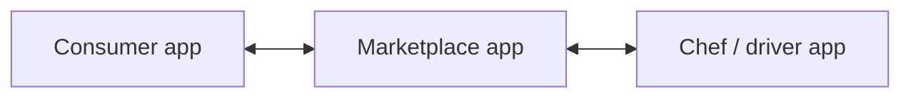

# Ziffyn

**An at-home chef service built from scratch as three connected applications.**

I built Ziffyn while teaching myself iOS development. The project brought together the customer experience, a marketplace, and the chef/driver side of the service. Building all three meant thinking through how one service should work for people using it in very different roles.

## Three apps, one service

| Application | Role in the product |
| --- | --- |
| Consumer app | The customer-facing experience for the at-home chef service |
| Marketplace app | The marketplace component connecting the service's participants |
| Chef/driver app | The application for the people providing and fulfilling the service |

This diagram describes the product roles, rather than a recovered backend or database architecture.

## What I built and learned

I learned iOS from scratch and built the three-app product. The challenge went beyond implementing individual screens: each application served a different user while participating in the same service. It was an early experience taking a product idea through the work of building its connected applications.

## About this repository

This is a project case study. The original application source and screenshots are not included in this public repository. It documents my work without presenting a recreated app as the original implementation.

[More of my work](https://github.com/Jaiashar)
