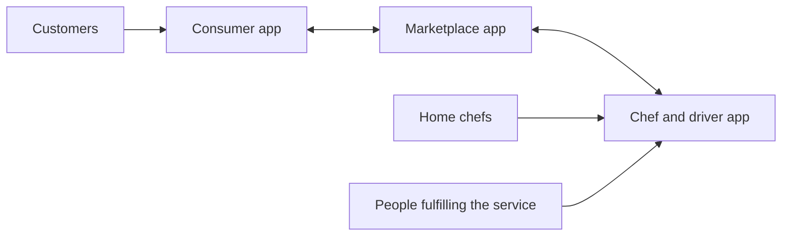
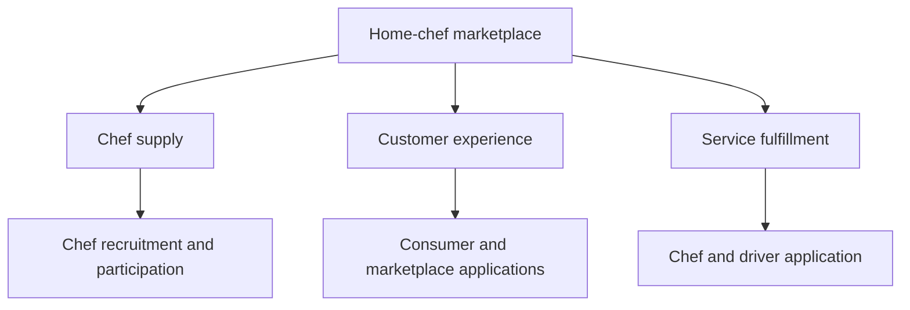

# Ziffyn

**A home-chef marketplace built around California's emerging home-kitchen framework, with hundreds of chefs recruited and three connected applications built from scratch.**

We saw an opportunity in talented home cooks who could serve customers without opening a conventional restaurant. Ziffyn connected that supply with people looking for home-cooked meals. We recruited hundreds of chefs, and I taught myself iOS development to build the consumer app, marketplace app, and chef/driver app from scratch.

The distinctive part was the combination of a focused market opportunity, the work of building chef supply, and software covering the different sides of the service.

## The niche: home cooks becoming food businesses

Ziffyn's premise centered on the **Microenterprise Home Kitchen Operation (MEHKO)** framework. California's AB 626 created a framework for permitted home-kitchen food businesses, with implementation dependent on local authorization. That gave us a specific market to build for: home chefs selling meals within the applicable home-kitchen rules. See the [California Department of Public Health's MEHKO guidance](https://www.cdph.ca.gov/Programs/CEH/DFDCS/Pages/FDBPrograms/FoodSafetyProgram/GeneralPermitRequirementsMEHKO.aspx).

The opportunity required both sides of the marketplace. Recruiting chefs created supply; a coherent customer experience made that supply discoverable and usable. Connecting those sides to the people preparing and fulfilling the service was the product problem I worked on.

[Shef](https://help.shef.com/en/articles/8009561-how-shef-works) is a useful category comparable: a marketplace where cooks sell homemade meals to customers. It gives readers a concrete reference for the kind of marketplace we were building.

## What we built

| Part of the work | Scope |
| --- | --- |
| Marketplace development | Recruited hundreds of chefs over the course of the project |
| Consumer application | Customer-facing side of the home-chef service |
| Marketplace application | Marketplace experience connecting customers and chef supply |
| Chef/driver application | Provider-facing side of service preparation and fulfillment |
| My engineering role | Built all three applications from scratch while learning iOS |

## Product architecture

The system had three application surfaces because customers, marketplace participants, and providers had different responsibilities. The diagrams reconstruct the product at the application and business-domain level; implementation details await recovery of the original source.

The architecture matters because one service crosses several interfaces. A customer-facing interaction has to make sense to the marketplace and to the provider fulfilling it. Building the three applications required thinking across those roles, rather than treating each screen as an isolated product.

### Domain boundaries

The application roles map to three related business domains: chef supply, the customer experience, and service fulfillment.

| Engineering concern | Why it matters in this product |
| --- | --- |
| Application boundaries | Each role needs a focused interface while participating in one service |
| Shared business concepts | Customers, chefs, and fulfillment must refer to the same underlying service |
| Cross-application coordination | Changes on one side need a coherent interpretation on the other sides |
| Real-world operations | Software must fit how chefs and customers actually use the service |
| Learning and delivery | I learned iOS while carrying implementation across all three applications |

These are the system-design concerns the product exposes. Backend technology, persistence, authentication, payment processing, dispatch algorithms, and exact state transitions need the original source or further implementation records before they can be documented accurately.

## Source availability

**This repository is a public product and engineering case study.** I have not yet recovered the original application repositories, so the three apps are not included here.

I am open to publishing the code once recovered and cleaned of credentials, personal records, signing material, and production configuration. That would allow this case study to include source-level architecture, build instructions, and a runnable example.

## Related work

- [Auricore Mobile](https://github.com/Jaiashar/auricore-mobile): public React Native source for item intake, inventory, and marketplace workflows.
- [PennOS](https://github.com/Jaiashar/penn-os): operating-system source, scheduler, process management, and filesystem implementation.
- [Full portfolio](https://github.com/Jaiashar): products, systems, and AWS infrastructure contributions.
