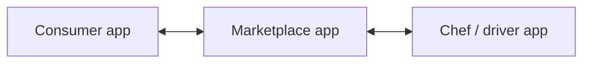

# Ziffyn

**An at-home chef service I built from scratch, with separate applications for consumers, the marketplace, and chefs/drivers.**

I taught myself iOS development to build Ziffyn. I built three connected applications around the different people involved in the service. The customer experience, marketplace, and service-provider experience had to fit together as one product.

## The product

Ziffyn was an at-home chef service. Its software had three major components:

| Application | Who it served | Responsibility in the product |
| --- | --- | --- |
| Consumer app | Customers using the service | The customer-facing experience |
| Marketplace app | Participants in the marketplace | The marketplace component connecting the service's different sides |
| Chef/driver app | People providing and fulfilling the service | The service-provider experience |

The diagram describes the product's three application roles. It does not specify an undocumented backend, database schema, or dispatch system.

## My work

I built the three applications from scratch and learned iOS along the way. This meant taking responsibility for both the product's different user experiences and the implementation work needed to make them part of the same service.

The project was an early example of how I approach building: learn the platform, break a larger product into clear responsibilities, and carry the implementation across those parts rather than stopping at a single interface.

## What this repository contains

This repository is a case study of the original project. The original application source, screenshots and a runnable build are not included. There are consequently no installation commands or demo credentials here.

## Related work

- [Auricore Mobile](https://github.com/Jaiashar/auricore-mobile): public React Native source for item intake, inventory and marketplace workflows.
- [PennOS](https://github.com/Jaiashar/penn-os): an operating-system project showing the systems side of my work.
- [Full portfolio](https://github.com/Jaiashar): products, systems and AWS infrastructure contributions.
