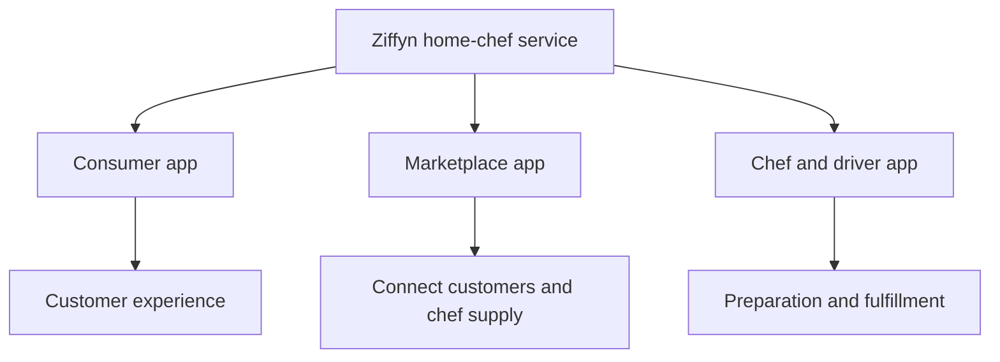

# Ziffyn

**A home-chef marketplace built around California's home-kitchen framework, with hundreds of chefs recruited and three connected applications built from scratch.**

**This is a product and engineering case study.** The original application source has not yet been recovered for publication, so this repository documents the product and my role rather than providing runnable apps.

We saw an opportunity in talented home cooks who could serve customers without opening a conventional restaurant. Ziffyn connected that supply with people looking for home-cooked meals. We recruited hundreds of chefs, and I taught myself iOS development to build the consumer app, marketplace app, and chef/driver app from scratch.

## The niche: home cooks becoming food businesses

Ziffyn's premise centered on the **Microenterprise Home Kitchen Operation (MEHKO)** framework. California's AB 626 created a framework for permitted home-kitchen food businesses, with implementation dependent on local authorization. That gave us a specific market to build for: home chefs selling meals within the applicable home-kitchen rules. See the [California Department of Public Health's MEHKO guidance](https://www.cdph.ca.gov/Programs/CEH/DFDCS/Pages/FDBPrograms/FoodSafetyProgram/GeneralPermitRequirementsMEHKO.aspx).

The work involved building both marketplace supply and the software to serve it. Recruiting chefs created supply; the consumer and marketplace experiences connected that supply to customers; the provider application supported the people preparing and fulfilling the service.

[Shef](https://help.shef.com/en/articles/8009561-how-shef-works) is a useful category comparable: a marketplace where cooks sell homemade meals to customers. It gives readers a reference for the kind of marketplace we were building, without implying an affiliation or equivalent scale.

## What we built

| Part of the work | Scope |
| --- | --- |
| Chef supply | Recruited hundreds of chefs over the course of the project |
| Consumer application | Customer-facing side of the home-chef service |
| Marketplace application | Marketplace experience connecting customers and chef supply |
| Chef/driver application | Provider-facing side of service preparation and fulfillment |
| My engineering role | Built all three applications from scratch while learning iOS |

## Product architecture

The service had three application surfaces for different participants. This diagram reconstructs their product roles. It is not a source-verified network or backend diagram.

Building across these roles meant coordinating the customer experience with the marketplace and the people fulfilling the service. The same product had to make sense from each participant's perspective, while supporting the practical work of recruiting and serving chefs.

The available records establish the three application roles and my implementation scope. Backend technology, persistence, authentication, payment processing, dispatch algorithms, and exact state transitions require the original source or further implementation records before they can be documented accurately.

## Source availability

I am open to publishing the original code once recovered and cleaned of credentials, personal records, signing material, and production configuration. That would allow this case study to include source-level architecture, build instructions, and a runnable example.

For public implementation examples now, see [PennOS](https://github.com/Jaiashar/penn-os), [PennShell](https://github.com/Jaiashar/penn-shell), and [Auricore Web](https://github.com/Jaiashar/auricore-web), a historical application snapshot. My [full portfolio](https://github.com/Jaiashar) also covers AWS inference infrastructure and GRASP Lab research.
